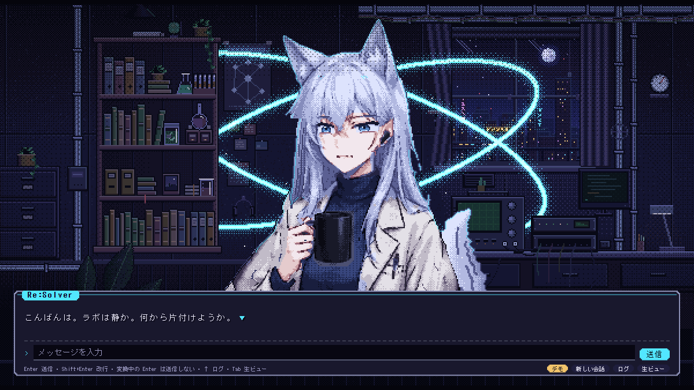

# Stira Stage(Stira-KIRO)

[English](README.md)



[Kiro Crew](https://github.com/kirodotdev/KiroCrew) 向けの、ドット絵のラボでエージェントと話し、
やったことを物語として残して後で引けるようにするアプリ。ラボがホーム画面で、テキストウィンドウで
キャラと会話し、棚で記憶の本を開き、窓の外に記憶が育つ森を見る。

状態: v0.5.1、開発中。Kiro Crew 0.11 以降。UI は日本語と英語(ダッシュボードの言語に合わせる)。

## できること
- **会話**: Stage のテキストウィンドウで Kiro と話す(ストリーム、停止、ログ、選択肢ボタン)。長い返答・SVG・`<mcwidget>` はホワイトボードに下りる
- **棚**: 環境メモ・作業日誌・ノート・プロジェクト・会話を本の背表紙で並べ、1冊ずつボードで読む
- **森**: 本1冊 = 木1本、章 = 葉、知識の葉は光る
- **章(ストーリー記憶)**: 会話を「状況 → 判断 → 結果 → 学び」と知識の葉にまとめる。アプリ内で自動(1日10章まで)、手直し・書き直し・外すができる
- **記憶を使う**: Stage では送るたびに関係する章と葉を添える。普段のチャットはスキル `stira-memory` が目次(`INDEX.md`)を案内する
- **部屋の反応**: ターン・ツール・記憶の出来事・他のセッションの作業にキャラと小物が応える

## 入れ方
このリポジトリがそのままレジストリになっている(直下の `app-registry.json`)。Kiro Crew の設定の
`registries` に次の 1 行を足すと、Apps の Discover に出る。

```json
{ "name": "resolver-tng", "repo": "https://github.com/Resolver-TNG/Stira-KIRO", "branch": "main" }
```

手で入れる場合は clone して `kirocrew app install <フォルダ>`。

## 入れる前に知っておくこと
- **第三者アプリ**。バックエンド(Python)を持ち、サブエージェントを起動する(`spawn`)ため、Library で信頼してから動く
- 使う API: `/api/apps/stira-kiro/*`、`/api/chat`、`/api/chat/slots/*`。アプリのページからの呼び出しはダッシュボードのユーザーとして動く
- **章の自動まとめ**は、会話の記録ファイルを読み、ツールを持たないエージェント `stira-chapter-writer` に要約させる。1章あたりおよそ 1 クレジット、1日 10 章まで。森の操作パネルからオフにできる
- 要約に渡す前に、トークンらしき文字列は伏せる(`backend/shelf.py` の `redact()`)。章は `~/.kiro/crew/workspace/memory/stira/` に Markdown で保存され、外には送らない
- 既知の制限: サブエージェントの返答を `~/.kiro/crew/subagents/<id>/result.txt` から読んでいる。これは Kiro Crew の内部ファイルで、更新で場所が変わると章の自動まとめが止まる
- 章の見出しと記憶の目次は日本語。章の中身は会話と同じ言語で書かれる
- アプリ独自の承認ゲートは足さない。ツールの承認は Kiro Crew の設定どおり

## 開発
- テスト: `node --test tests/kc_core.test.mjs` / `<Kiro Crew 同梱の python> tests/test_chapters.py`
- 開発モード: `python -m kiro_crew app dev`(Kiro Crew 同梱の python)で入れた後、入ったアプリの `ui` をこのリポジトリの `ui` へのジャンクション(シンボリックリンク)にすると、UI の変更が再読み込みで反映される。バックエンド・スキル・エージェント・`app.json` の変更は Library の「同期」が要る
- Stage の取り込み直し: `node tools/sync_stage.mjs`(StiraCore の Stage をコピーして差分を当てる。当たらない差分があれば止まる)
- モーション解析: `node tools/frames.mjs --state <状態>` → `uv run --with pillow tools/analyze_frames.py <フォルダ>`
- ストア画像: `tools/make_store_art.py` の冒頭のコマンド

## 出典
- Stage・ホワイトボード: [Resolver-TNG/StiraCore](https://github.com/Resolver-TNG/StiraCore)(Apache-2.0、素材 CC BY 4.0)
- three.js(MIT)。詳細は NOTICE と `third_party/`

## ライセンス
Apache-2.0([LICENSE](LICENSE))。キャラと部屋の素材は CC BY 4.0(NOTICE 参照)。
