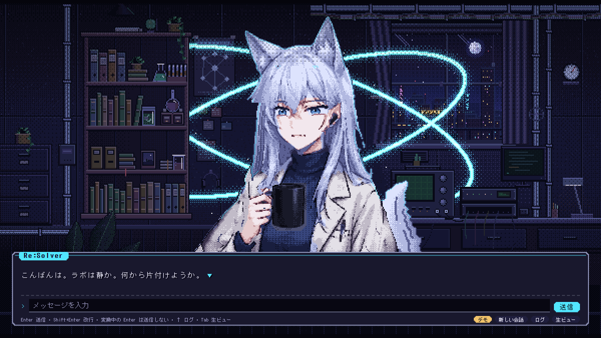

# Stira Stage (Stira-KIRO)

[日本語](README.ja.md)



A [Kiro Crew](https://github.com/kirodotdev/KiroCrew) app for talking to your agent in a pixel-art lab,
and for keeping what you did as a story you can find again. The lab is the home screen: you talk
to the character in a text window, open memory books on the shelf, and watch a forest of memories
grow outside the window.

Status: v0.7.1, in development. Requires Kiro Crew 0.11 or later. UI in English and Japanese
(follows the dashboard's language).

## What it does
- **Talk**: chat with Kiro in the Stage's text window (streaming, stop, log, option buttons). Long replies, SVG and `<mcwidget>` go to the whiteboard.
- **Shelf**: environment notes, the work journal, notes, projects and conversations stand as book spines; open one at a time on the board.
- **Forest**: one tree per book, one leaf per chapter; knowledge leaves glow.
- **Chapters (story memory)**: conversations are summarized as "situation → decisions → outcome → lessons" plus knowledge leaves. Runs inside the app (up to 10 chapters a day); you can edit, rewrite or drop a chapter.
- **Using memory**: on the Stage, each message carries the related chapters and leaves. In ordinary chats, the `stira-memory` skill points Kiro at the index (`INDEX.md`).
- **The room reacts**: turns, tools, memory events and other sessions' work move the character and the props.
- **Narratives**: from the chapters, each book gets a short "where this stands" (latest outcome, the arc so far, recent decisions, lessons). Built by plain rules with no model call, refreshed whenever chapters change. Lessons that recur in two or more chapters become promotion candidates for you to turn into lessons or steering.
- **Workbench**: the desk in the room shows your local Git repositories, read only. Each repository is a note on the wall (a red "!" when it needs attention), and the desk opens a to-do list: behind its upstream, stale worktrees, uncommitted changes, unpushed commits and so on. Pick folders to watch from the desk's **Folders** screen. Nothing contacts a remote except the per-repository **fetch** button.
- **Bot dashboard (experimental)**: optionally sends the workbench summary to one Kiro Crew Bot's Dashboard page through member records, while Stage is open. Off until you name a Bot. See `docs/bot-dashboard.md`.

## Which Stira?
- **Stira Forest** ([Resolver-TNG/Stira-Forest-KiroCrew](https://github.com/Resolver-TNG/Stira-Forest-KiroCrew)): for Kiro Crew as it ships. Install, enable, set each crew's core mission, and its knowledge grows as a tree. No steering or hooks to edit.
- **Stira Stage** (this repo): for people who customize Kiro Crew. On top of the app, the optional [`kiro-pack/`](kiro-pack/README.md) adds the three-layer memory control: the core (steering, every session) → the narrative (a hook attaches the one related book's narrative to a message) → episodes (chapters, opened on demand). The narrative never outranks the core.

## Install
This repository is its own registry (`app-registry.json` at the root). Add this to `registries`
in your Kiro Crew config and the app shows up in Apps → Discover:

```json
{ "name": "resolver-tng", "repo": "https://github.com/Resolver-TNG/Stira-KIRO", "branch": "main" }
```

Or clone it and run `kirocrew app install <folder>`.

## Before you install
- This is a **third-party app**. It has a Python backend and starts subagents (`spawn`), so you trust it in the Library before it runs.
- APIs it calls: `/api/apps/stira-kiro/*`, `/api/chat`, `/api/chat/slots/*`. Calls from the app page run as the dashboard user.
- **Automatic chapters** read your conversation files and ask a tool-less agent, `stira-chapter-writer`, to summarize them. About 1 credit per chapter, at most 10 a day. Turn it off from the forest's control panel.
- Credential-shaped text is masked before anything is summarized (`redact()` in `backend/shelf.py`). Chapters are saved as Markdown in `~/.kiro/crew/workspace/memory/stira/` and are not sent anywhere else.
- Known limitation: the app reads a subagent's reply from `~/.kiro/crew/subagents/<id>/result.txt`. That is a Kiro Crew internal file; if a Kiro Crew update moves it, automatic chapters stop.
- Chapter headings and the memory index are written in Japanese; chapter text follows the language of the conversation.
- The app adds no approval gates of its own. Tool approvals follow your Kiro Crew settings.

## Development
- Tests: `node --test tests/kc_core.test.mjs` and `<python bundled with Kiro Crew> -m pytest -q tests`
- Dev mode: install with `python -m kiro_crew app dev` (Kiro Crew's bundled python), then make the installed app's `ui` folder a junction (symlink) to this repo's `ui`. UI changes then apply on reload. Changes to the backend, skills, agents or `app.json` need "Sync" in the Library.
- Re-import the Stage: `node tools/sync_stage.mjs` (copies StiraCore's Stage and applies the patches; fails loudly when one no longer matches).
- Motion analysis: `node tools/frames.mjs --state <state>` → `uv run --with pillow tools/analyze_frames.py <folder>`
- Store images: see the command at the top of `tools/make_store_art.py`.

## Credits
- Stage and whiteboard: [Resolver-TNG/StiraCore](https://github.com/Resolver-TNG/StiraCore) (Apache-2.0, art CC BY 4.0)
- three.js (MIT). See NOTICE and `third_party/`.

## License
Apache-2.0 (see [LICENSE](LICENSE)). The character and room art are CC BY 4.0 (see NOTICE).
